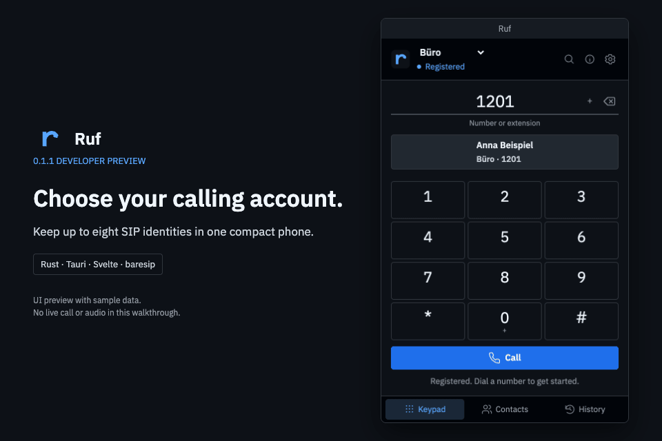
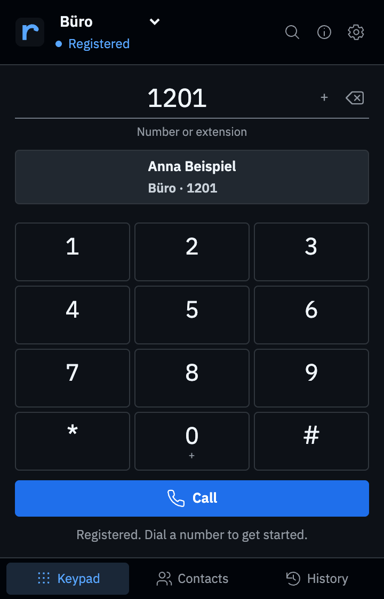
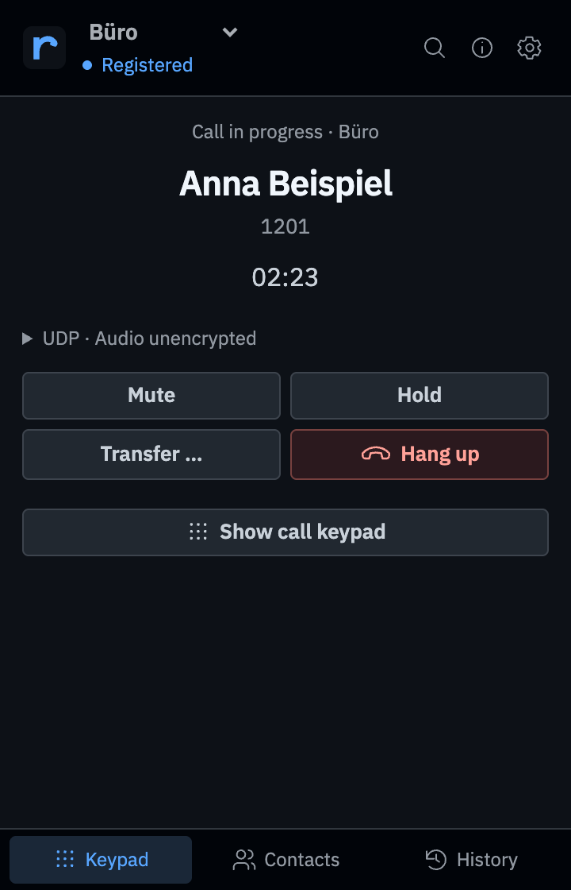
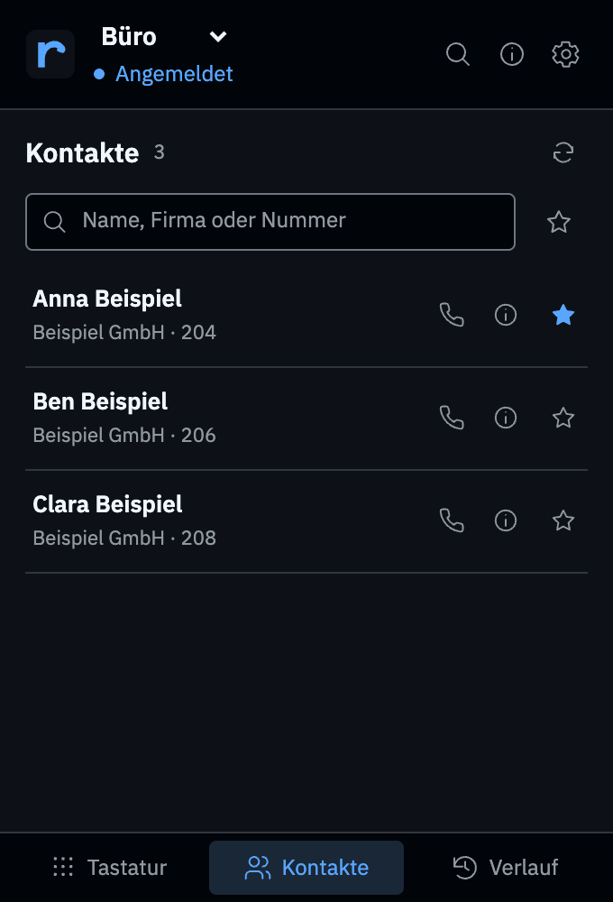
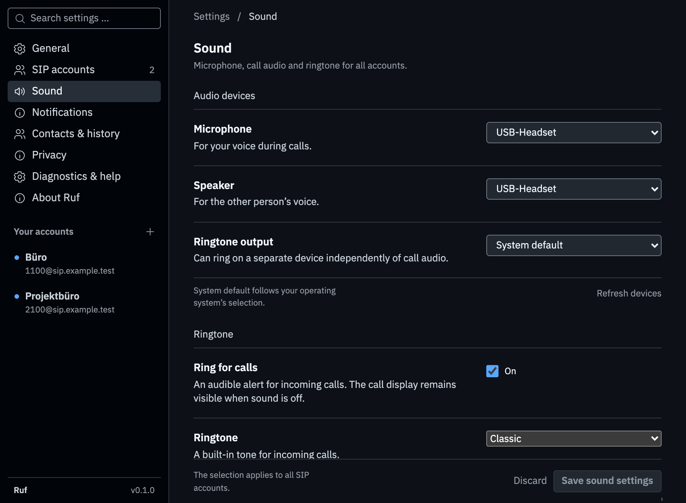

<div align="center">


# Ruf

**A compact SIP softphone for macOS and Windows.**

[](https://github.com/mardu-systems/ruf/actions/workflows/ci.yml)
[](docs/releases/0.1.1.md)
[](docs/development.md)
[](LICENSE)

[Get the preview](docs/testing-preview.md#get-the-preview) · [Watch the UI demo](#ui-demo) · [Report a bug](https://github.com/mardu-systems/ruf/issues/new?template=bug_report.yml) · [Help test compatibility](docs/testing-preview.md#help-test-compatibility)

</div>

Ruf connects your desktop to a SIP telephone system. Dial numbers or extensions,
manage multiple accounts, and keep contacts and recent calls in a clear interface.
Mute, hold, the DTMF keypad and transfer controls stay within reach during a call.

This is a Developer Preview for isolated test networks, not production use.

## UI demo



This 30-second walkthrough uses the real interface with synthetic IPC states,
fictional contacts and no live SIP or audio. German and English are available;
the captures show English. [Media provenance and regeneration](docs/screenshots/README.md).

## Screenshots

<table>
  <tr>
    <th>Dialer</th>
    <th>Active call</th>
    <th>Contacts</th>
  </tr>
  <tr>
    <td></td>
    <td></td>
    <td></td>
  </tr>
</table>

<details>
<summary>View audio settings</summary>



</details>

The screenshots show the current English interface with fictional demo accounts
and contacts. They do not establish real calling or operating-system acceptance.

## Features

| Area                  | What Ruf offers                                                                                                     |
| --------------------- | ------------------------------------------------------------------------------------------------------------------- |
| **Multiple accounts** | Up to eight saved SIP accounts, independently enabled, with a selectable outgoing identity.                         |
| **Calls**             | Answer, reject, hang up, mute, hold and send native DTMF tones for digits, star and hash.                           |
| **Transfers**         | Transfer directly or start a consultation, switch between calls and complete the attended transfer.                 |
| **macOS contacts**    | Search after explicit permission, use favorites and identify matching contacts while dialing or on a call.          |
| **Local history**     | Call outcomes and duration, callbacks through the original account, and configurable history storage and retention. |
| **Audio**             | Select microphone, call speaker and ringtone outputs separately, and check them with short audio tests.             |
| **Desktop**           | Tray menu, background operation, keyboard shortcuts and search with ⌘K or Ctrl+K; incoming notifications on macOS.  |
| **Languages**         | German and English across the phone, settings and native presentation; follows the system or your saved selection.  |

Rust and Tauri 2 power the desktop application, with Svelte for the interface.
SIP and audio run natively through baresip. Original project code uses the
[MIT license](LICENSE); dependencies retain their own licenses.

## Status and limitations

- Target platforms are **macOS 14+ on Apple Silicon** and **Windows 11 x64**.
  A successful build does not replace testing on physical audio hardware or
  against your own telephone system. See the
  [verification records](docs/verification/README.md) for results and boundaries.
- Default direct-distribution builds use ad hoc signing on macOS; Windows
  installers are unsigned. Local Developer ID signing is separately documented,
  but it does not establish notarization or the identity of a future hosted
  installer. Check each release's actual asset status. The
  [release checklist](docs/release-checklist.md) tracks qualification steps.
- Accounts support UDP, TCP and TLS, plus required SDES-SRTP with TLS.
  UDP/TCP and ordinary RTP are unencrypted. TLS verifies certificates and hosts
  through the operating system, with no automatic plaintext fallback. Call
  security indicators follow actual native observations. Protection to the
  telephone system is not end-to-end encryption.
- At most two related dialogs share one audible conversation. Passwords are
  stored in macOS Keychain or Windows Credential Manager.
- Windows contacts, calendar integration and automatic updates are not yet available.

Ruf remains free and open source on GitHub, with no in-app purchases.
An optional paid Mac App Store release is planned.

## Run locally

Use the Bun and Rust versions pinned in `.bun-version` and `rust-toolchain.toml`,
and install the [Tauri prerequisites](https://v2.tauri.app/start/prerequisites/).
The native SDK requires CMake and OpenSSL; see the
[native build guide](native/README.md) for platform-specific setup.

```sh
bun install --frozen-lockfile
bun run native:build
bun run dev:native
```

A fresh installation starts without a SIP account. `bun run dev` starts Tauri
without native telephony; `bun run dev:web` runs the web interface only.

Build commands, toolchain setup and checks are in the
[development guide](docs/development.md). SIP/RTP integration tests use the
[optional Asterisk lab](tests/interop/asterisk/README.md).

Use `bun run clean` to remove local build and test outputs. Preview with
`bun run clean --dry-run`; add `--all` to also remove the native SDK and
workspace dependencies. See the [cleanup contract](docs/api/tooling.md#cleanup).

## Project layout

| Path                     | Responsibility                                     |
| ------------------------ | -------------------------------------------------- |
| `apps/desktop/src`       | Svelte interface                                   |
| `apps/desktop/src-tauri` | Tauri app, IPC, storage and desktop integration    |
| `crates/phone-core`      | Platform-independent Rust contracts and validation |
| `crates/baresip-adapter` | Native SIP and audio integration                   |
| `native`                 | Pinned SDK builds and license texts                |
| `tests/interop`          | Asterisk integration tests                         |
| `.github`                | CI, installers and draft releases                  |

## Documentation

- [Architecture](docs/architecture.md), [development](docs/development.md) and
  [API contracts](docs/api/README.md)
- [CI/CD and signing](docs/ci-cd.md), [release checklist](docs/release-checklist.md)
  and [verification records](docs/verification/README.md)
- [License](LICENSE), [dependency attribution](docs/licensing.md) and
  [privacy policy draft](docs/privacy-policy-ruf.en.md)
- [Code of conduct](CODE_OF_CONDUCT.md) and [security reports](SECURITY.md)

## Contributing

Windows headset tests, FreeSWITCH interoperability reports and first-run Mac
feedback are welcome. See [CONTRIBUTING.md](CONTRIBUTING.md) and the
[compatibility guide](docs/testing-preview.md#help-test-compatibility).
Keep credentials and personal account, contact and call data out of reports.
