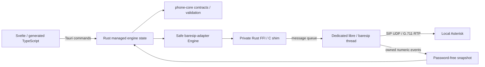

# Architecture

The Cargo workspace has three packages. `sip-desktop` composes `phone-core` and
`baresip-adapter`. Core owns validated input/output contracts and single-call
preconditions, independently of Tauri, C handles or network implementations.
The Bun workspace contains the plain Svelte/Vite frontend.

Tauri exposes explicitly permitted commands scoped to the phone and settings
windows; see the [IPC reference](api/README.md). There is no general
shell/filesystem/network plugin capability. Blocking engine work runs through
Tauri's existing blocking runtime. A managed mutex serializes desktop commands;
callbacks update a separate snapshot mutex. Events and polling project real state
into the frontend. Browser preview explicitly reports the absent desktop runtime;
its regression fixtures provide synthetic IPC only.

Native support is opt-in through Cargo feature `native`. Portable builds reject
engine startup and report `notLinked`. Native builds link pinned static baresip,
libre and OpenSSL plus selected modules. `linked` describes compilation only.
One engine owns upstream process-global state; it supports up to eight independently
registered accounts and one concurrent call. Passwords enter through native authentication setters, never account
URIs or disk config. C code runs account/call operations on its event-loop thread.
Shutdown flags the loop and joins it before destroying callback ownership.

Audio remains within baresip: AudioUnit on macOS, WASAPI on Windows, or tone/file
modules for the automated RTP echo test. Device routing and native ringing use
that same pipeline. The native event loop handles interface changes and SIP/UDP
NAT mapping; this does not certify arbitrary public-network/provider compatibility.
See [native build details](../native/README.md).

The desktop stores password-free account/settings metadata in `accounts.json`.
Passwords use OS credential storage, with explicit foreground recovery after
access failure and no plaintext fallback. Call facts queue to a single SQLite
history worker without disk I/O under native call locks. Authorized macOS Contacts
data remains an in-memory projection; contact names are not copied into call
history. Favorites store only contact identifiers. Contacts integration is not
available on Windows. Contracts and recovery behavior are documented in
[contacts](api/contacts.md), [history](api/history.md) and
[credential recovery](api/credential-recovery.md).

The native process owns startup restoration, tray actions, background ringing and
notification observation independently of webview visibility. A single-instance
plugin reopens the existing phone. Closing the phone hides it; explicit Quit joins
the native engine before draining history writes.

The application identifier is `org.rufapp.desktop`, with Ruf icon assets. macOS
bundles include microphone/contact purpose strings and hardened-runtime
entitlements. Ad-hoc signing is configured; production signing/notarization,
Windows runtime and hardware permission/device qualification remain separate from
the headless media test. TLS/SRTP, calendar integration and automatic updates are
not implemented. See the [release checklist](release-checklist.md).
