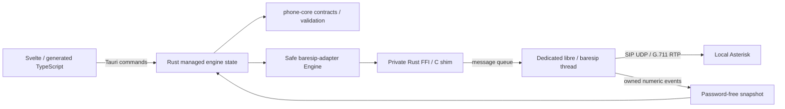

# Architecture

The Cargo workspace has three packages. `sip-desktop` composes `phone-core` and
`baresip-adapter`. Core owns validated input/output contracts and single-call
preconditions, independently of Tauri, C handles or network implementations.
The npm workspace contains the plain Svelte/Vite frontend.

Tauri exposes six explicitly permitted commands; there is no HTTP API or general
shell/filesystem/network plugin capability. Blocking engine work runs through
Tauri's existing blocking runtime. A managed mutex serializes desktop commands;
callbacks update a separate snapshot mutex. Polling projects real state into the
frontend. Browser preview explicitly reports the absent desktop runtime.

Native support is opt-in through Cargo feature `native`. Portable builds reject
engine startup and report `notLinked`. Native builds link pinned static baresip,
libre and OpenSSL plus selected modules. `linked` describes compilation only.
One engine owns upstream process-global state; it uses one ephemeral account and
one call. Passwords enter through native authentication setters, never account
URIs or disk config. C code runs account/call operations on its event-loop thread.
Shutdown flags the loop and joins it before destroying callback ownership.

Audio remains within baresip: AudioUnit on macOS, WASAPI on Windows, or tone/file
modules for the automated RTP echo test. Test recordings are explicit disk output;
no contact/history/account database exists yet. TLS/SRTP, keyring persistence,
multiple accounts, contacts/history/calendar and public-network NAT traversal
remain subsequent milestones. No second audio stack or unused platform bindings
are introduced. See [native build details](../native/README.md).

The temporary identifier `org.sipsoftphone.desktop` and placeholder icons still
need final selection before user-facing distribution. macOS builds contain a
microphone usage description; signing/notarization and hardware permission/device
validation remain separate from the headless media test.
