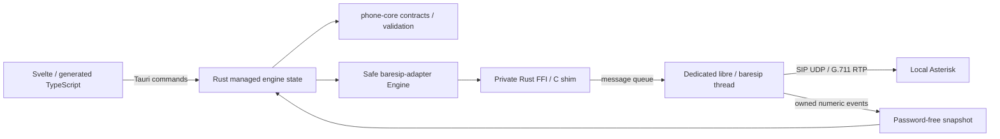

# Architecture

The Cargo workspace has three packages. `sip-desktop` composes `phone-core` and
`baresip-adapter`. Core owns validated input/output contracts and single-call
preconditions, independently of Tauri, C handles or network implementations.
The Bun workspace contains the plain Svelte/Vite frontend.

Tauri exposes explicitly permitted commands scoped to the phone and settings
windows; see the [IPC reference](api/README.md). There is no general
shell/filesystem/network plugin capability. Blocking engine work runs through
Tauri's existing blocking runtime. A managed mutex serializes desktop commands;
callbacks update a separate snapshot mutex. Events and polling project real state
into the frontend. Browser preview explicitly reports the absent desktop runtime;
its regression fixtures provide synthetic IPC only.

Native support is opt-in through Cargo feature `native`. Portable builds reject
engine startup and report `notLinked`. Native builds link pinned static baresip,
libre and OpenSSL plus selected modules. `linked` describes compilation only.
One engine owns upstream process-global state; it supports up to eight independently
registered accounts and at most two related dialogs for a call and its consultation,
with one audible conversation. Passwords enter through native authentication setters, never account
URIs or disk config. C code runs account/call operations on its event-loop thread.
Shutdown flags the loop and joins it before destroying callback ownership.

Audio remains within baresip: AudioUnit on macOS, WASAPI on Windows, or tone/file
modules for the automated RTP echo test. Device routing and native ringing use
that same pipeline. The native event loop handles interface changes and SIP/UDP
NAT mapping; this does not certify arbitrary public-network/provider compatibility.
See [native build details](../native/README.md).

The desktop stores password-free account/settings metadata in schema-v2
`accounts.json`, with an original-byte backup before replacing a legacy-v1 file.
Preferences include login presentation, notification privacy, contact display and
history collection/retention. Disabled accounts retain keys/selection and restore
without password access or native user-agent creation. Passwords use OS credential
storage, with explicit foreground recovery after access failure and no plaintext fallback. Call facts queue to a single SQLite
history worker without disk I/O under native call locks. The same ordered worker
latches history collection at call start and prunes completed rows on policy
changes, startup and daily intervals. Authorized macOS Contacts
data remains an in-memory projection; contact names are not copied into call
history. Favorites store only contact identifiers. Contacts integration is not
available on Windows. Contracts and recovery behavior are documented in
[contacts](api/contacts.md), [history](api/history.md) and
[credential recovery](api/credential-recovery.md).

The native process owns startup restoration, tray actions, background ringing and
notification observation independently of webview visibility. A single-instance
plugin reopens the existing phone. Closing the phone hides it; explicit Quit joins
the native engine before draining history writes. Login launches use the saved
hidden-start preference; manual launches show the phone. Native permission queries
bypass account/keychain restoration. Anonymous test notifications have independent
ownership, and diagnostic reports serialize an explicit nonidentifying whitelist.

Settings remain one native window with eight typed sections, guarded drafts and
field-search IDs. Microphone/speaker diagnostics reuse the native baresip source,
player and event loop, with bounded duration and real-call preemption; there is
no browser capture or second audio pipeline. See [preferences](api/preferences.md),
[notifications](api/notifications.md), [diagnostics](api/diagnostics.md),
[account activation](api/account-activation.md) and [audio tests](api/audio-diagnostics.md).

The application identifier is `org.rufapp.desktop`, with Ruf icon assets. macOS
bundles include microphone/contact purpose strings and hardened-runtime
entitlements. Ad-hoc signing is configured; production signing/notarization,
Windows runtime and hardware permission/device qualification remain separate from
the headless media test. UDP/TCP/TLS and required SDES-SRTP with TLS are implemented;
per-call security reports native observations independently of account policy.
Calendar integration and automatic updates are not implemented. See the
[account security contract](api/account-security.md) and
[release checklist](release-checklist.md).
